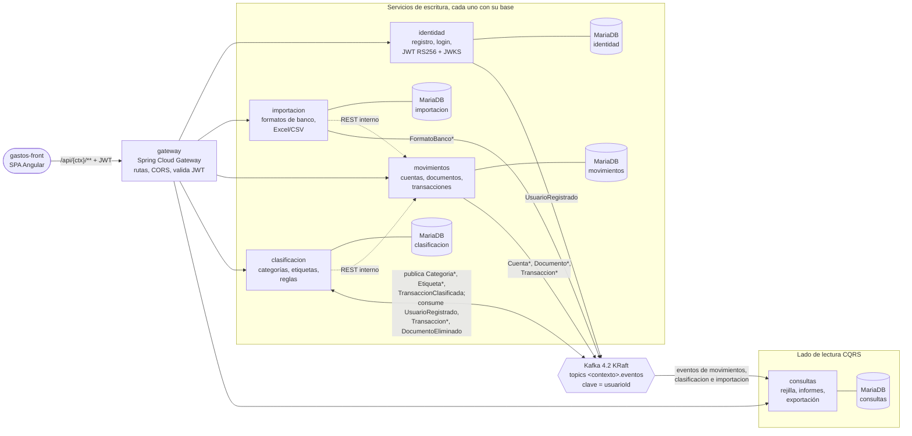
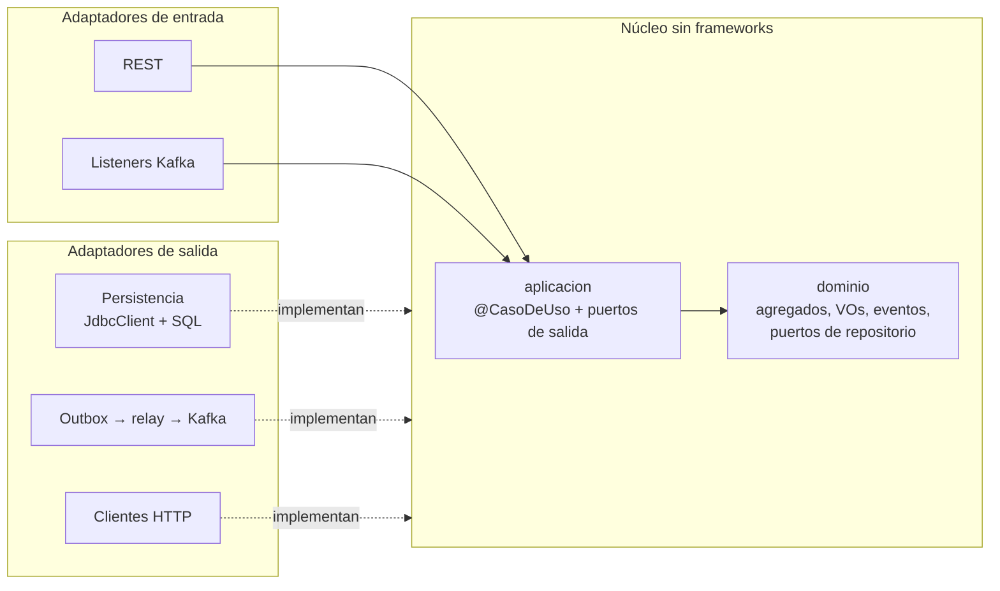

# Gastos2

Back de **Gastos** (control de gastos personal: importar extractos bancarios, clasificar los
movimientos con categorías y etiquetas, y ver informes) reescrito desde cero como
**microservicios**, aplicando **DDD** (estratégico y táctico), **Clean Architecture** y
**arquitectura hexagonal** (puertos y adaptadores).

Sustituye al monolito `Gastos/gastos-back`. Además de cambiar la arquitectura, corrige sus defectos
conocidos (dinero en `float`, nombres repetidos, orden de clasificación arbitrario, borrados que
fallaban…). Todo lo que cambia está en [docs/comparativa-con-gastos-back.md](docs/comparativa-con-gastos-back.md).

## Arquitectura

Cinco servicios, uno por contexto acotado, más un gateway. Cada servicio tiene su propia base de datos y
publica sus eventos en su propio topic de Kafka a través de un outbox; entre servicios solo hay REST donde
la respuesta se necesita en el momento.



Dentro de cada servicio de negocio el núcleo es Java puro y las dependencias solo apuntan hacia él: los
adaptadores implementan los puertos que define el núcleo (lo comprueba ArchUnit en cada build).



Decisiones clave:
- **Una base de datos por servicio**: nadie lee la de otro; los datos ajenos llegan por eventos o por API
  interna y las referencias entre contextos son ids ([ADR 0001](docs/adr/0001-microservicios-por-contexto-acotado.md)).
- **Kafka con un topic por contexto y el usuario como clave**, para tener orden por usuario, con retención
  infinita ([ADR 0004](docs/adr/0004-kafka-topic-por-contexto-clave-usuario.md)). Se publica con
  **outbox transaccional** y los consumidores con efectos usan **inbox** contra duplicados, ambos hechos
  a mano ([ADR 0005](docs/adr/0005-outbox-e-inbox-propios.md)).
- **JWT RS256** emitido por identidad y validado con su JWKS en el gateway y en cada servicio; las
  llamadas internas reenvían el JWT del usuario ([ADR 0008](docs/adr/0008-jwt-rs256-con-jwks.md),
  [ADR 0019](docs/adr/0019-gateway-webflux.md)).
- **consultas es el lado de lectura CQRS** y se reconstruye reproduciendo los topics desde el principio
  ([ADR 0010](docs/adr/0010-consultas-cqrs-reconstruible-por-replay.md)).
- **Núcleo sin frameworks**, con `UnidadDeTrabajo` en vez de `@Transactional`
  ([ADR 0006](docs/adr/0006-unidad-de-trabajo-en-vez-de-transactional.md)) y persistencia con
  `JdbcClient` y SQL explícito ([ADR 0022](docs/adr/0022-persistencia-con-jdbcclient.md)).

El detalle (C4, escenarios, conceptos transversales) está en [docs/arquitectura/](docs/arquitectura/) y
los eventos, en el [catálogo](docs/eventos/catalogo.md).

**Stack:** Java 21 · Spring Boot 4.1.1 · Spring Cloud 2025.1.3 (Gateway Server WebFlux) · Spring
Security (OAuth2 resource server) · Spring Kafka · Apache Kafka 4.2 (KRaft) · MariaDB 11.8 ·
JdbcClient + Flyway · Apache POI 5.5.1 · JUnit 5 + Testcontainers + ArchUnit 1.5.1 · Docker Compose ·
Maven multi-módulo.

## Arrancarlo

Requisitos: Java 21 y Docker Desktop. Maven no hace falta, se usa el wrapper.

```bash
docker compose up -d mariadb kafka --wait   # infraestructura
./mvnw verify                               # compila y pasa todos los tests (unitarios, IT con Testcontainers, arquitectura)
docker compose up -d --build --wait         # todo el stack (a medida que se añaden los servicios)
```

## Estructura

| Carpeta | Contenido |
|---|---|
| `compartido/kernel` | Kernel compartido: `UsuarioId`, `Importe`, normalización, clave de concepto, base de agregados y puertos comunes |
| `compartido/pruebas` | Soporte de tests: reglas ArchUnit, contenedores (MariaDB, Kafka), dobles |
| `servicios/*` | Un microservicio por contexto acotado: identidad, movimientos, clasificacion, importacion, consultas, gateway |
| `docs/` | Documentación: arquitectura (arc42 + C4), dominio, decisiones (ADR), eventos, API y proceso |
| `infra/` | Scripts de inicialización de MariaDB y claves de desarrollo |

## Documentación

Empieza por [docs/README.md](docs/README.md). Las decisiones de arquitectura y su porqué están en
[docs/adr/](docs/adr/), y el diario de construcción en [docs/proceso/bitacora.md](docs/proceso/bitacora.md).
