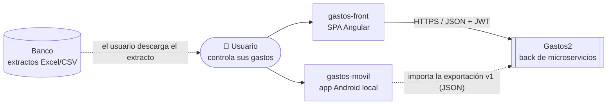
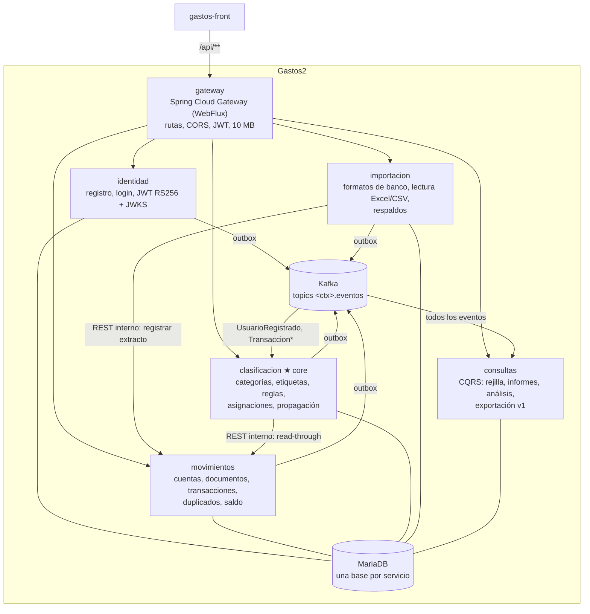

# 2. Contexto y contenedores (C4 niveles 1 y 2)

## Nivel 1: contexto del sistema

- El **usuario** descarga los extractos de su banco y los sube a través del front.
- **gastos-movil** no habla con el back en línea: restaura un fichero JSON de exportación (formato v1)
  que genera el back. Es el formato que hay que mantener compatible.

## Nivel 2: contenedores

| Contenedor | Responsabilidad | Tecnología | Datos propios |
|---|---|---|---|
| gateway | Única entrada desde fuera; enruta `/api/{contexto}/**`, valida el JWT, aplica CORS y el límite de subida, bloquea `/internal/**` | Spring Cloud Gateway Server WebFlux | — |
| identidad | Usuarios, contraseñas, emisión de tokens y publicación de la clave pública (JWKS) | Spring Boot (WebMVC) | `identidad` |
| movimientos | Hechos bancarios: cuentas, documentos importados, transacciones; detecta duplicados al importar | Spring Boot | `movimientos` |
| clasificacion | Catálogo (categorías y etiquetas con sus ocurrencias y prioridad) y la clasificación de cada transacción | Spring Boot | `clasificacion` |
| importacion | Interpreta los ficheros de cada banco según su formato y entrega líneas limpias a movimientos; orquesta la restauración de respaldos | Spring Boot + Apache POI | `importacion` |
| consultas | Modelo de lectura que combina los datos de todos los contextos para la rejilla, los informes y la exportación | Spring Boot + JdbcClient | `consultas` (desechable: se reconstruye desde Kafka) |
| Kafka | Log de eventos de integración con retención infinita; fuente para reconstruir consultas | Apache Kafka 4.2 (KRaft) | volumen `datos-kafka` |
| MariaDB | Una base de datos y un usuario por servicio | MariaDB 11.8 | volumen `datos-mariadb` |

**Cómo se comunican:**
- **Síncrono (REST):** solo donde la respuesta se necesita en el momento.
  - importacion → movimientos, para registrar un extracto y devolver duplicados.
  - clasificacion → movimientos, para conocer una transacción recién creada antes de que llegue su
    evento.

  Estas llamadas reenvían el JWT del usuario.
- **Asíncrono (eventos):** todo lo demás. Cada servicio publica en su topic y no sabe quién lo consume.

Por qué se dividió así: ADR [0001](../adr/0001-microservicios-por-contexto-acotado.md),
[0002](../adr/0002-asignaciones-en-clasificacion.md) y [0003](../adr/0003-importacion-como-capa-anticorrupcion.md).
