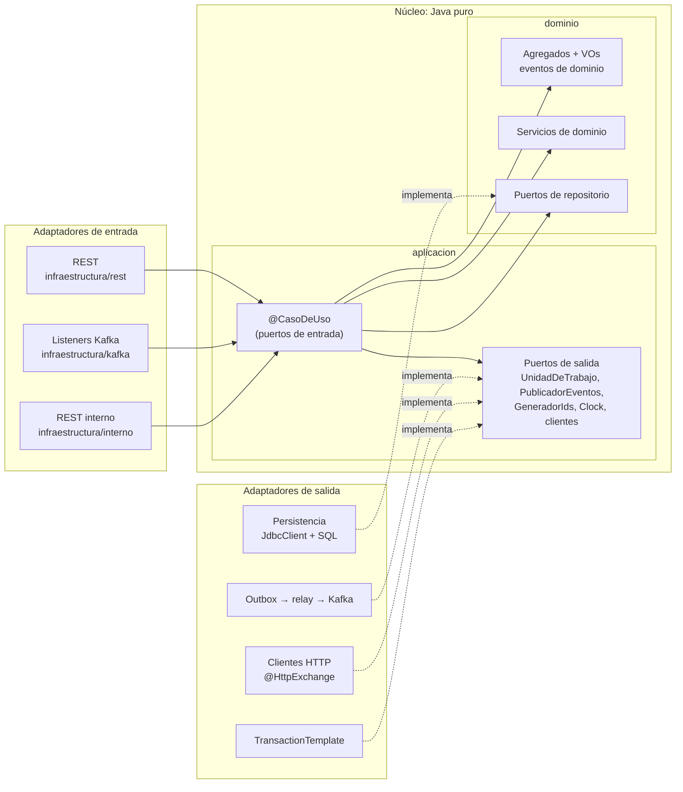

# 3. Componentes de cada servicio (C4 nivel 3)

Todos los servicios de negocio siguen la misma forma hexagonal
([ADR 0006](../adr/0006-unidad-de-trabajo-en-vez-de-transactional.md)). Este documento muestra la
plantilla común y, por cada servicio, sus puertos y adaptadores concretos. La sección de cada servicio
se añade en la fase en que se construye.

## Plantilla común

**Regla de dependencia.** Las flechas de código solo apuntan hacia el núcleo. Los adaptadores
**implementan** los puertos (las líneas punteadas) y el núcleo nunca conoce a los adaptadores. Lo verifica
`ReglasArquitectura` en cada build.

## Servicios

| Servicio | Sección | Fase |
|---|---|---|
| identidad | (pendiente) | F1 |
| gateway | (pendiente) | F2 |
| movimientos | (pendiente) | F3–F4 |
| clasificacion | (pendiente) | F5–F6 |
| importacion | (pendiente) | F7 |
| consultas | (pendiente) | F8–F9 |
