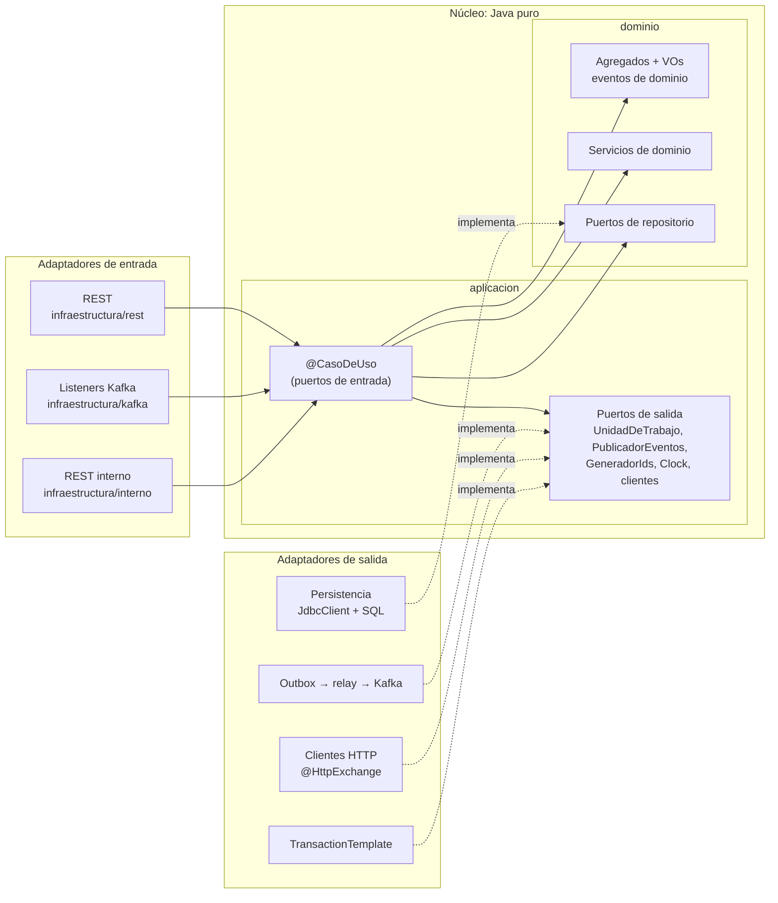
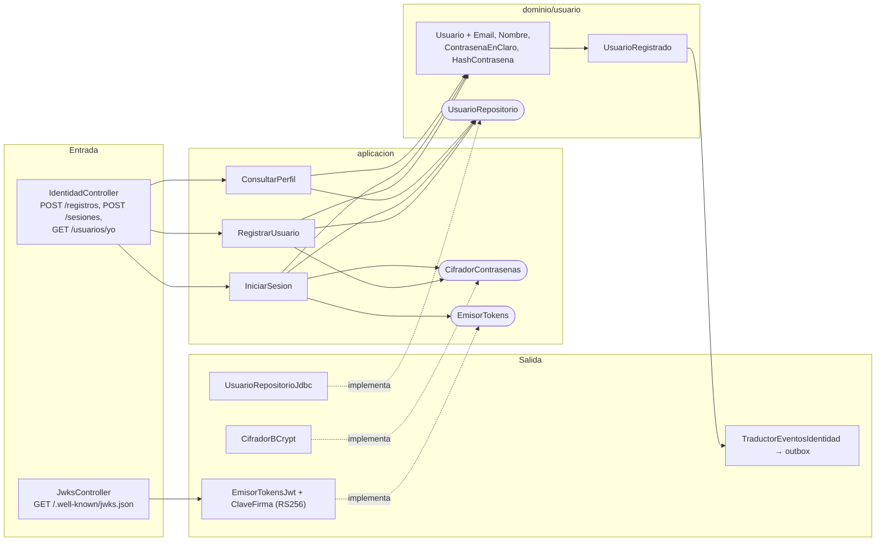
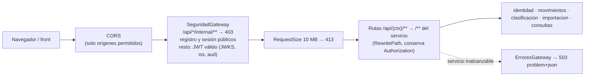

# 3. Componentes de cada servicio (C4 nivel 3)

Todos los servicios de negocio siguen la misma forma hexagonal
([ADR 0006](../adr/0006-unidad-de-trabajo-en-vez-de-transactional.md)). Este documento muestra la
plantilla común y, por cada servicio, sus puertos y adaptadores concretos. La sección de cada servicio
se añade en la fase en que se construye.

## Plantilla común

**Regla de dependencia.** Las flechas de código solo apuntan hacia el núcleo. Los adaptadores
**implementan** los puertos (las líneas punteadas) y el núcleo nunca conoce a los adaptadores. Lo verifica
`ReglasArquitectura` en cada build.

## Servicios

| Servicio | Sección | Fase |
|---|---|---|
| identidad | [identidad](#identidad) | F1 ✅ |
| gateway | [gateway](#gateway) | F2 ✅ |
| movimientos | (pendiente) | F3–F4 |
| clasificacion | (pendiente) | F5–F6 |
| importacion | (pendiente) | F7 |
| consultas | (pendiente) | F8–F9 |

## identidad

Los puertos de salida (óvalos) los define el núcleo y los implementan los adaptadores. La traducción
del evento de dominio al contrato `identidad.v1.UsuarioRegistrado` ocurre en la infraestructura: el
dominio no conoce el lenguaje publicado.

## gateway

No tiene capas de dominio ni de aplicación: es infraestructura pura y está configurado de forma
declarativa ([ADR 0019](../adr/0019-gateway-webflux.md)).

| Pieza | Responsabilidad |
|---|---|
| `application.yaml` | Rutas por contexto, filtro `RequestSize` por defecto y URL de cada servicio (`gastos.servicios.*`) |
| `SeguridadGateway` | `SecurityWebFilterChain` reactiva, decodificador JWT con JWKS + emisor + audiencia, CORS |
| `ErroresGateway` | Convierte "no se puede conectar con el servicio" en 503 RFC 9457 `SERVICIO_NO_DISPONIBLE` |
