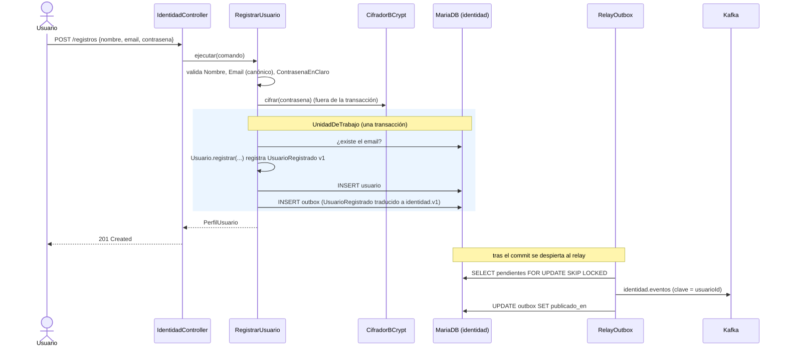

# 4. Escenarios (vista de ejecución)

Diagramas de secuencia de los flujos importantes. Cada escenario se añade (y se verifica contra el
código) en la fase en que se implementa.

| Escenario | Fase | Estado |
|---|---|---|
| [Registro de usuario y publicación del evento](#41-registro-de-usuario) | F1 | ✅ |
| [Inicio de sesión y petición autenticada](#42-inicio-de-sesión-y-petición-autenticada) | F1 (directo) / F2 (gateway) | ✅ directo |
| Siembra del catálogo al registrarse | F5 | pendiente |
| Importación de un extracto (importacion → movimientos → clasificación automática → consultas) | F7 | pendiente |
| Crear y clasificar una transacción a mano (dos servicios, *read-through*) | F6 | pendiente |
| Leer lo que acabas de escribir (`Gastos-Secuencia` / `Gastos-Esperar`) | F8 | pendiente |
| Borrar una categoría usada por etiquetas y transacciones | F5 | pendiente |
| Reconstruir consultas reproduciendo Kafka | F9 | pendiente |
| Restaurar un respaldo v1 (migración desde el back antiguo) | F10 | pendiente |

## 4.1 Registro de usuario



**Fallos posibles:**
- **Email repetido:** el caso de uso lanza `Conflicto` → 409 `EMAIL_YA_REGISTRADO`. Si dos registros
  simultáneos pasan la comprobación, la restricción `UNIQUE` hace fallar el segundo `INSERT` y el
  adaptador lo traduce al mismo 409. La transacción se deshace, outbox incluido: no se publica nada.
- **Kafka caído:** el usuario queda registrado igualmente, y el evento sigue pendiente en el outbox
  hasta que el relay consigue enviarlo.

## 4.2 Inicio de sesión y petición autenticada

```mermaid
sequenceDiagram
    actor U as Usuario
    participant I as identidad
    participant S as cualquier servicio
    U->>I: POST /sesiones {email, contrasena}
    I->>I: busca por email canónico y comprueba BCrypt
    Note right of I: email inexistente: BCrypt ficticio (mismo tiempo) → 401
    I-->>U: {token RS256 (kid, iss, aud, sub, email, nombre, exp), tipo: Bearer, expiraEnSegundos}
    U->>S: GET … Authorization: Bearer token
    S->>I: GET /.well-known/jwks.json (solo la primera vez; se cachea)
    S->>S: valida firma, exp, iss=gastos-identidad, aud=gastos-api
    S->>S: @UsuarioActual = sub
    S-->>U: respuesta con solo los datos de ese usuario
```

A partir de F2, el usuario habla con el gateway, que valida el token antes de enrutar. Los servicios lo
vuelven a validar como defensa en profundidad.
