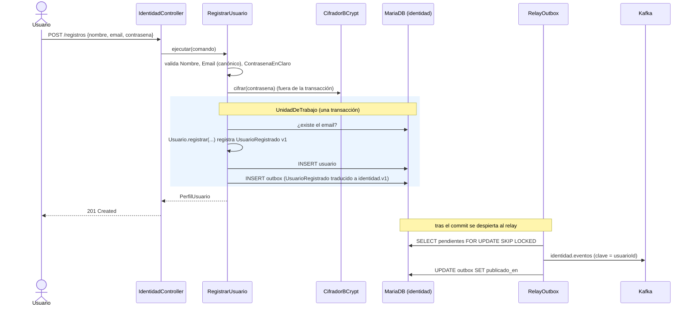
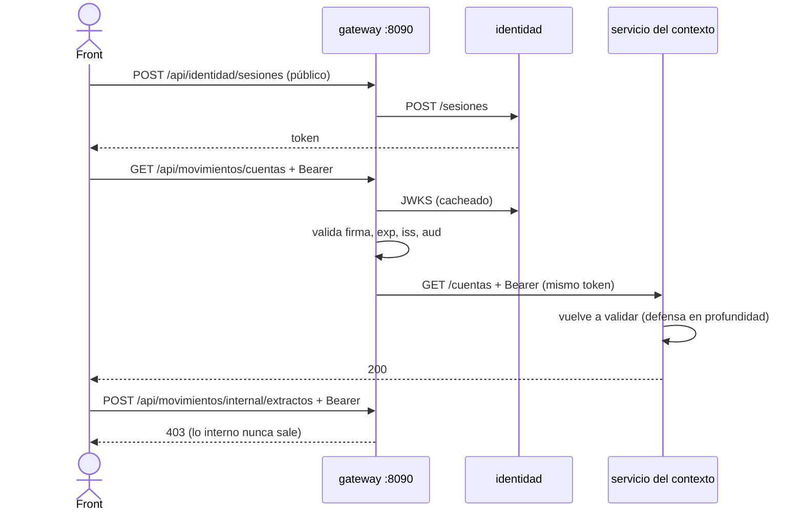
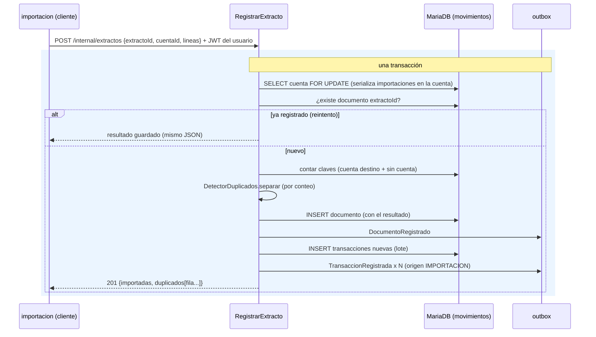
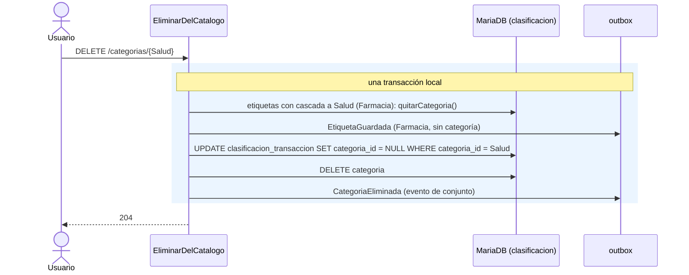
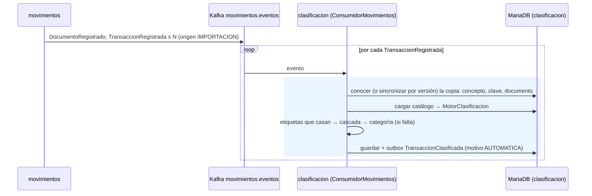
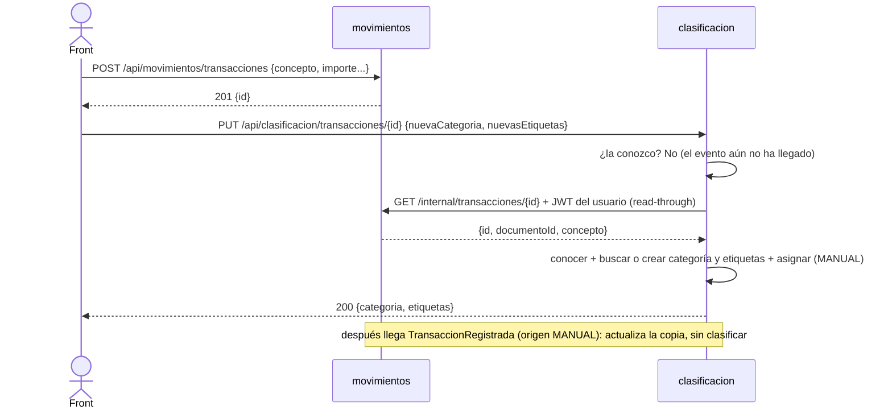
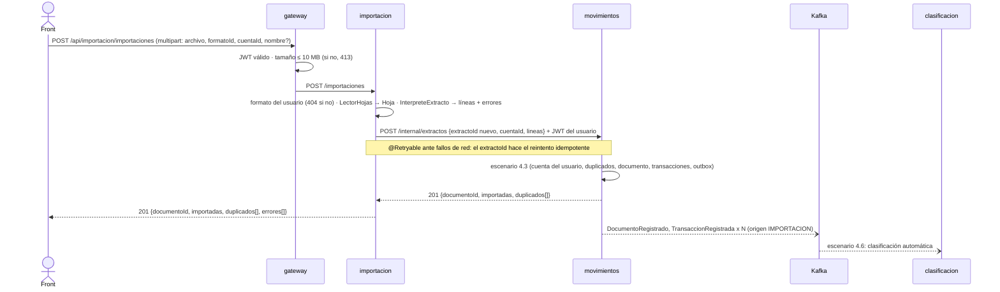
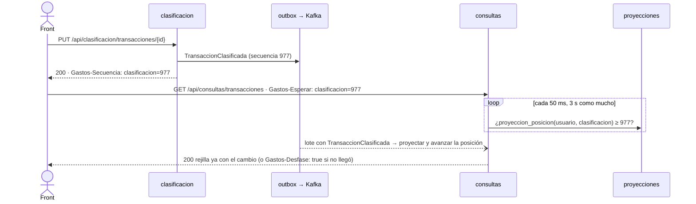

# 4. Escenarios (vista de ejecución)

Diagramas de secuencia de los flujos importantes. Cada escenario se añade (y se verifica contra el
código) en la fase en que se implementa.

| Escenario | Fase | Estado |
|---|---|---|
| [Registro de usuario y publicación del evento](#41-registro-de-usuario) | F1 | ✅ |
| [Inicio de sesión y petición autenticada](#42-inicio-de-sesión-y-petición-autenticada) | F1 (directo) / F2 (gateway) | ✅ |
| [Siembra del catálogo al registrarse](#44-siembra-del-catálogo-al-registrarse) | F5 | ✅ |
| [Registro de un extracto en movimientos](#43-registro-de-un-extracto-en-movimientos) | F4 | ✅ |
| [Importación de un extracto de punta a punta](#48-importación-de-un-extracto-de-punta-a-punta) | F7 (consultas en F8) | ✅ |
| [Clasificación automática de un extracto importado](#46-clasificación-automática-de-un-extracto-importado) | F6 | ✅ |
| [Crear y clasificar una transacción a mano (dos servicios, *read-through*)](#47-crear-y-clasificar-una-transacción-a-mano) | F6 | ✅ |
| [Leer lo que acabas de escribir (`Gastos-Secuencia` / `Gastos-Esperar`)](#49-leer-lo-que-acabas-de-escribir) | F8 | ✅ |
| [Borrar una categoría usada por etiquetas y transacciones](#45-borrar-una-categoría-usada) | F5 | ✅ |
| [Reconstruir consultas reproduciendo Kafka](#410-reconstruir-consultas-reproduciendo-kafka) | F9 | ✅ |
| [Restaurar un respaldo v1 (migración desde el back antiguo)](#411-restaurar-un-respaldo-v1) | F10 | ✅ |

## 4.1 Registro de usuario



**Fallos posibles:**
- **Email repetido:** el caso de uso lanza `Conflicto` → 409 `EMAIL_YA_REGISTRADO`. Si dos registros
  simultáneos pasan la comprobación, la restricción `UNIQUE` hace fallar el segundo `INSERT` y el
  adaptador lo traduce al mismo 409. La transacción se deshace, outbox incluido: no se publica nada.
- **Kafka caído:** el usuario queda registrado igualmente, y el evento sigue pendiente en el outbox
  hasta que el relay consigue enviarlo.

## 4.2 Inicio de sesión y petición autenticada

```mermaid
sequenceDiagram
    actor U as Usuario
    participant I as identidad
    participant S as cualquier servicio
    U->>I: POST /sesiones {email, contrasena}
    I->>I: busca por email canónico y comprueba BCrypt
    Note right of I: email inexistente: BCrypt ficticio (mismo tiempo) → 401
    I-->>U: {token RS256 (kid, iss, aud, sub, email, nombre, exp), tipo: Bearer, expiraEnSegundos}
    U->>S: GET … Authorization: Bearer token
    S->>I: GET /.well-known/jwks.json (solo la primera vez; se cachea)
    S->>S: valida firma, exp, iss=gastos-identidad, aud=gastos-api
    S->>S: @UsuarioActual = sub
    S-->>U: respuesta con solo los datos de ese usuario
```

A partir de F2, el usuario habla con el gateway, que valida el token antes de enrutar. Los servicios lo
vuelven a validar como defensa en profundidad.

### A través del gateway (F2)



## 4.3 Registro de un extracto en movimientos



**Por qué es seguro reintentar.** Si la respuesta se pierde por un timeout, importacion repite la
llamada con el mismo `extractoId` y recibe el mismo resultado; nada se importa dos veces. Si dos
importaciones distintas del mismo fichero llegan a la vez, el bloqueo de la cuenta hace que la segunda
vea las filas de la primera como duplicadas (lo comprueba `ExtractosIT`).

## 4.4 Siembra del catálogo al registrarse

Es la primera colaboración entre servicios por eventos.

```mermaid
sequenceDiagram
    participant I as identidad
    participant K as Kafka identidad.eventos
    participant C as clasificacion (ConsumidorIdentidad)
    participant DB as MariaDB (clasificacion)
    I->>K: UsuarioRegistrado (vía outbox)
    K->>C: entrega (al menos una vez)
    rect rgb(235, 245, 255)
    Note over C,DB: una transacción
    C->>DB: INSERT inbox (eventoId, "clasificacion.siembra"); si ya existía, termina
    C->>DB: INSERT IGNORE catalogo_sembrado; si ya estaba sembrado, termina
    C->>DB: 12 categorías + 23 etiquetas (prioridad = orden del fichero)
    C->>DB: outbox: CategoriaGuardada x 12, EtiquetaGuardada x 23
    end
```

**Siembra perezosa.** Si el usuario llega a clasificacion antes que el evento (por ejemplo, Kafka va
lento), el primer caso de uso que ejecuta siembra en su propia transacción. Cuando llega el evento,
`catalogo_sembrado` ya existe y no hace nada. Medido en el smoke de F5: el catálogo estaba sembrado
**1 s** después del registro, sin ninguna petición a clasificacion.

## 4.5 Borrar una categoría usada



En el back antiguo esta operación fallaba con un 500 por la clave foránea de las etiquetas. Aquí es
posible en una transacción porque catálogo y asignaciones viven en el mismo servicio
([ADR 0002](../adr/0002-asignaciones-en-clasificacion.md)).

## 4.6 Clasificación automática de un extracto importado



Resultado medido en el smoke de F6 con el catálogo inicial:

| Concepto | Categoría | Etiquetas |
|---|---|---|
| "COMPRA LUPA SANTANDER" | Alimentacion (cascada) | Supermercado |
| "PAYPAL *SPOTIFY" | **Ocio y cultura** (cascada de Suscripciones, que tiene más prioridad que Compras online) | Suscripciones, Compras online |
| "BIZUM: Cena" | (ninguna) | Bizum |

## 4.7 Crear y clasificar una transacción a mano

El front crea los hechos en movimientos y la clasifica en clasificacion justo después, antes de que el
evento haya llegado ([ADR 0002](../adr/0002-asignaciones-en-clasificacion.md)).



Si la transacción no existe o es de otro usuario, movimientos responde 404 y clasificacion devuelve el
mismo 404.

## 4.8 Importación de un extracto de punta a punta



**Quién responde a qué.** Los errores de lectura y de interpretación son de importacion (400
`FICHERO_ILEGIBLE`, filas en `errores[]`); la propiedad de la cuenta y los duplicados, de movimientos,
que es dueño de esos datos. importacion traduce las respuestas de movimientos sin cambiar su `codigo`:
el cliente ve el mismo 404 por una cuenta ajena que si la hubiera pedido a movimientos.

**La respuesta no espera a la clasificación.** Llega en cuanto movimientos confirma; la categoría y las
etiquetas aparecen unos milisegundos después. Las consultas lo resolverán con `Gastos-Esperar` (F8,
[ADR 0011](../adr/0011-leer-lo-que-acabas-de-escribir.md)).

Resultado medido en el smoke de F7, a través del gateway, con [`http/extracto-ejemplo.csv`](../../http/extracto-ejemplo.csv)
y un xlsx con fechas reales de Excel y una fórmula:

| Paso | Resultado |
|---|---|
| 1.ª importación del CSV (6 filas) | 201: 5 importadas (los dos Bizum idénticos son dos movimientos), 1 error `Fila 6: fecha con formato incorrecto: '31/02/2026'` |
| 2.ª importación del mismo CSV | 201: 0 importadas, 5 duplicadas |
| xlsx (fecha de tipo fecha, importe por fórmula) | 2 importadas; al repetir, 2 duplicadas |
| Otro usuario importa en esa cuenta | 404 `RECURSO_NO_ENCONTRADO` (respondido por movimientos y propagado) |
| Saldo de la cuenta | 2775,67 (la última fila con saldo; las del xlsx no traen saldo y no cuentan) |
| Clasificación automática, unos ms después | COMPRA LUPA → Alimentacion + Supermercado; FARMACIA → Salud + Farmacia; NETFLIX → Ocio y cultura + Suscripciones; NOMINA → Ingresos + Nomina; PAYPAL *SPOTIFY → Ocio y cultura + Suscripciones, Compras online; BIZUM → etiqueta Bizum |

## 4.9 Leer lo que acabas de escribir

([ADR 0011](../adr/0011-leer-lo-que-acabas-de-escribir.md)) El front clasifica una transacción y vuelve
a pedir la rejilla, que sale de consultas, un lado de lectura con consistencia eventual.



**El front solo necesita un interceptor:** guardar el máximo de cada contexto que ve en
`Gastos-Secuencia` y enviarlo en `Gastos-Esperar` en las consultas. Ninguna pantalla tiene que saber
qué servicio escribió qué.

Resultado medido en el smoke de F8, a través del gateway:

| Paso | Resultado |
|---|---|
| Importar 2 filas y pedir la rejilla con `Gastos-Esperar: movimientos=<n>` | Las 2 filas, sin desfase (165 ms) |
| Clasificar a mano y pedir el detalle con `Gastos-Esperar: clasificacion=<n>` | Ya trae la categoría nueva (28 ms) |
| Borrar el documento (204 con `Gastos-Secuencia`) y pedir la rejilla esperando esa secuencia | Vacía |
| `Gastos-Esperar` con una secuencia que no llegará | 200 con `Gastos-Desfase: true` a los 3,08 s |
| Extracto de 150 filas / de 2000 filas | Rejilla completa en 224 ms / 2,6 s |

## 4.10 Reconstruir consultas reproduciendo Kafka

([ADR 0010](../adr/0010-consultas-cqrs-reconstruible-por-replay.md)) Se tira la proyección y se rehace
desde el log, por ejemplo tras cambiar su esquema o para repararla.

```mermaid
sequenceDiagram
    actor O as Operador
    participant S as reconstruir-consultas.sh
    participant Q as consultas
    participant DB as proyecciones
    participant K as Kafka (retención infinita)
    O->>S: reconstruir (versión N+1)
    S->>Q: recrear con GASTOS_CONSULTAS_PROYECCION_VERSION=N+1 (guardada en .env)
    Q->>DB: Flyway; ¿proyeccion_estado = N+1? No
    Q->>DB: vaciar proyecciones y posiciones + fijar N+1 (una transacción)
    Q->>K: grupo consultas-vN+1 · al recibir las particiones, seekToBeginning
    loop lotes de hasta 500 eventos
        K-->>Q: eventos desde el principio
        Q->>DB: proyectar (idempotente por versión) y avanzar posiciones
    end
    S->>Q: GET /actuator/health/proyeccion hasta retraso = 0
    S-->>O: reconstruida en N s
```

Resultado medido en F9: `scripts/reconstruir-consultas.sh` de la versión 1 a la 2 releyó 5066 eventos
(2213 de movimientos y 2853 de clasificacion) en 18 s contando el arranque del contenedor. Los 9 informes
y la rejilla de dos usuarios salieron idénticos byte a byte, y los totales siguieron cuadrando con las
fuentes.

## 4.11 Restaurar un respaldo v1

([ADR 0020](../adr/0020-restauracion-v1-con-uuid-originales.md)) El usuario sube el JSON exportado por el
back antiguo, por el móvil o por `GET /api/consultas/exportacion/v1`.

```mermaid
sequenceDiagram
    actor U as Front
    participant I as importacion
    participant M as movimientos
    participant C as clasificacion
    participant K as Kafka
    participant Q as consultas
    U->>I: POST /api/importacion/respaldos?modo=SUSTITUIR (JSON v1)
    I->>I: TraductorRespaldoV1: ids y fechas; fuera las transacciones sin fecha o importe
    I->>M: PUT /internal/respaldos/v1 (cuentas, documentos, transacciones) + JWT
    M->>M: PlanRestauracion · borrar lo del usuario · MovimientosRestaurados + altas (ids originales)
    M-->>I: {cuentas, documentos, transacciones, anomalias} · Gastos-Secuencia
    I->>C: PUT /internal/respaldos/v1 (catálogo, asignaciones) + JWT
    C->>C: PlanRestauracion · borrar catálogo y clasificaciones · marcar sembrado · ClasificacionRestaurada + altas
    C-->>I: {categorias, etiquetas, clasificadas, anomalias} · Gastos-Secuencia
    I->>I: PlanFormatos · FormatosRestaurados + formatos
    I-->>U: informe + Gastos-Secuencia de los tres
    K--)Q: cada reinicio limpia solo su parte; las altas (versión 1) reviven las filas
```

Con `modo=SIMULAR` (el valor por defecto) se hacen las mismas llamadas con `simular=true`: cada servicio
construye su plan y devuelve conteos y anomalías sin escribir nada.
