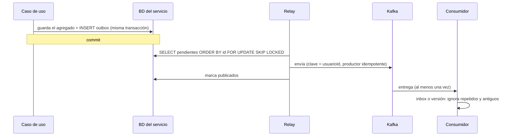

# 5. Conceptos transversales

Mecanismos que comparten todos los servicios. Cada sección indica dónde está implementado.

## 5.1 Propiedad de los datos (multiusuario)

- **Todo agregado tiene un propietario** (`UsuarioId`, del kernel) y `RaizAgregado.perteneceA(usuario)`.
- **El usuario sale siempre del token:** el `sub` del JWT, inyectado en los controladores como
  `@UsuarioActual UsuarioId`. Nunca del cuerpo ni de los parámetros.
- **El caso de uso comprueba la propiedad:** un recurso ajeno lanza `RecursoNoEncontrado` (404, igual
  que uno inexistente, para no revelar que existe).
- **Las listas filtran siempre por el usuario** en el propio puerto del repositorio.

## 5.2 Agregados, versiones y eventos de dominio

Implementado en `kernel/dominio/RaizAgregado`.

- Un agregado se carga y se guarda entero. Lleva `versionCargada`, para el bloqueo optimista, y
  `version`, la actual.
- **Cada cambio con significado:**
  1. llama a `siguienteVersion()`;
  2. registra un evento con esa versión.

  Así cada evento tiene una versión única por agregado, aunque haya varios en la misma operación.
- **El repositorio guarda** con `UPDATE … SET version = :nueva WHERE id = :id AND version = :cargada`.
  Si no afecta a ninguna fila, lanza `Conflicto.modificacionConcurrente` (409).

## 5.3 Unidad de trabajo

- Es el puerto `kernel/aplicacion/UnidadDeTrabajo` ([ADR 0006](../adr/0006-unidad-de-trabajo-en-vez-de-transactional.md)).
- Todo lo que hay dentro de `ejecutar(...)` se confirma o se deshace junto: cambios de agregados y filas
  del outbox.

## 5.4 Eventos de integración: outbox, relay e inbox

Implementado en `compartido/mensajeria` ([ADR 0005](../adr/0005-outbox-e-inbox-propios.md)).



- **Sobre de cada evento:**
  `{eventoId, tipo, contexto, version, secuencia, ocurridoEn, usuarioId, agregadoId, versionAgregado, datos}`.
- **Garantías:**
  - Entrega **al menos una vez**.
  - **Orden por usuario dentro de cada contexto**, porque la clave es `usuarioId`
    ([ADR 0004](../adr/0004-kafka-topic-por-contexto-clave-usuario.md)).
  - Ningún orden entre contextos.
- **Consumidores:**
  - **Con efectos** (sembrar el catálogo, clasificar al importar): usan el inbox.
  - **Proyecciones:** usan la versión (`WHERE version_x < ?`) y lápidas.
- **Errores:** un evento que falla repetidamente va a `<topic>-dlt` y no bloquea la partición.

## 5.5 Seguridad

[ADR 0008](../adr/0008-jwt-rs256-con-jwks.md).
- **Emisión:** identidad firma los JWT con RS256 y publica el JWKS.
- **Validación:** el gateway y los servicios validan firma, `exp`, `iss=gastos-identidad` y
  `aud=gastos-api`.
- **Llamadas internas:** reenvían el JWT del usuario.
- **Endpoints internos:** cuelgan de `/internal/**`. El gateway no los enruta y en compose solo el gateway
  publica puerto.

## 5.6 Errores (RFC 9457)

Implementado en `compartido/web`. Todas las respuestas de error son `application/problem+json`:

```json
{
  "type": "urn:gastos:problema:nombre-duplicado",
  "title": "Conflicto",
  "status": 409,
  "detail": "Ya existe la categoría con el nombre 'Salud'",
  "codigo": "NOMBRE_DUPLICADO",
  "errores": [ { "campo": "nombre", "mensaje": "..." } ]
}
```

| Excepción o situación | Estado |
|---|---|
| `ExcepcionDominio`, validación de entrada, JSON o UUID malformado | 400 |
| Token ausente o inválido | 401 |
| `RecursoNoEncontrado` (también si es ajeno) | 404 |
| `Conflicto` (nombre duplicado, modificación concurrente, cuenta con movimientos) | 409 |
| Fichero mayor de 10 MB | 413 |
| Tipo de fichero no soportado | 415 |
| Servicio dependiente no disponible | 503 |

## 5.7 Dinero, texto y fechas

- **Dinero:** `Importe` (kernel), con `BigDecimal` a escala 2 y `DECIMAL(15,2)` ([ADR 0012](../adr/0012-importe-bigdecimal.md)).
- **Texto:**
  - `Normalizador.normalizar` sirve para comparar sin tildes ni mayúsculas conservando los espacios.
  - `normalizarNombre` sirve para la unicidad de nombres ([ADR 0013](../adr/0013-nombres-unicos-normalizados.md)).
  - `ClaveConcepto` sirve para detectar similares.
- **Fechas:**
  - El "hoy" sale siempre de un `Clock` inyectado con zona `Europe/Madrid`.
  - Las fechas de negocio son `LocalDate`, y las marcas técnicas, `Instant` en UTC.
