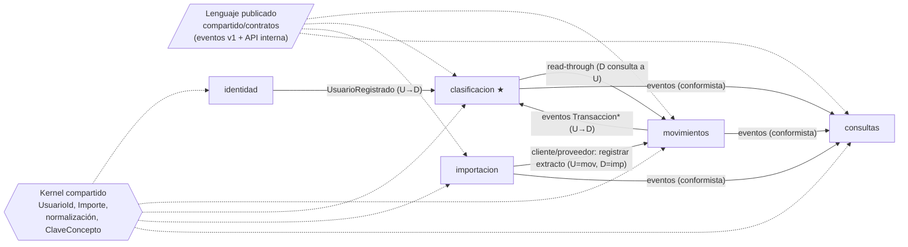

# Mapa de contextos

## Subdominios

| Subdominio | Tipo | Por qué | Contexto |
|---|---|---|---|
| Clasificación de movimientos | **Core** | Es lo que diferencia a la aplicación: reglas por ocurrencias, prioridad, cascada, propagación. Merece el modelo más cuidado y la mayor cobertura de tests. | `clasificacion` |
| Registro de movimientos bancarios | Soporte | Necesario pero sin reglas complejas: guardar hechos, detectar duplicados, saldo. | `movimientos` |
| Interpretación de extractos | Soporte | Traducir el formato de cada banco a un modelo limpio. | `importacion` |
| Análisis e informes | Soporte | Cálculos de lectura sobre datos de varios contextos. | `consultas` |
| Identidad y acceso | Genérico | Resuelto de forma estándar (contraseña + JWT). Podría sustituirse por un proveedor externo. | `identidad` |

## Relaciones entre contextos

U = upstream (proveedor) y D = downstream (consumidor).

| Relación | Patrón | Qué significa aquí |
|---|---|---|
| Todos ↔ kernel | **Shared kernel** | Un núcleo mínimo con semántica idéntica en todos los contextos (identidad del usuario, dinero, normalización de texto, clave de concepto). Se cambia con cuidado: afecta a todos. Regla de admisión: solo entra si al menos dos contextos necesitan *exactamente* lo mismo. |
| Productores → consumidores | **Lenguaje publicado** (*published language*) | Los eventos de integración (`compartido/contratos`, paquetes `v1`) son un contrato versionado e independiente del modelo interno de cada servicio. El dominio emite eventos de dominio; la infraestructura los traduce al contrato. |
| importacion → movimientos | **Cliente/proveedor** | importacion (cliente) necesita registrar extractos y saber qué filas eran duplicadas; movimientos (proveedor) ofrece `POST /internal/extractos` con un contrato pensado para ese cliente. |
| Bancos → importacion | **Capa anticorrupción** (ACL) | Cada banco tiene su formato (columnas, fechas, separadores decimales). importacion lo traduce a `LineaExtracto`, el modelo limpio que entiende movimientos. Ningún otro contexto sabe de Excel ni de bancos. |
| movimientos → clasificacion | Upstream/downstream por eventos | clasificacion mantiene una copia mínima de cada transacción (concepto, documento) para clasificar sin preguntar a movimientos. Si la copia aún no existe, consulta a movimientos (*read-through*). |
| todos → consultas | **Conformista** | consultas adopta tal cual los modelos que publican los demás y los combina en su modelo de lectura; no impone nada aguas arriba. |
| identidad → clasificacion | Upstream/downstream por eventos | Al registrarse un usuario, clasificacion siembra su catálogo inicial. |

## Qué datos son de quién

| Dato | Dueño (escribe) | Copias (solo lectura, por eventos) |
|---|---|---|
| Usuario | identidad | — (los demás solo guardan su `UsuarioId`) |
| Cuenta, Documento, Transacción (hechos) | movimientos | consultas; clasificacion guarda concepto y documento de cada transacción |
| Categoría, Etiqueta, clasificación de cada transacción | clasificacion | consultas |
| Formato de banco | importacion | consultas (para la exportación v1) |

Regla: **un dato solo se modifica en su servicio dueño**. Las copias son eventualmente consistentes y
nunca se editan directamente.
